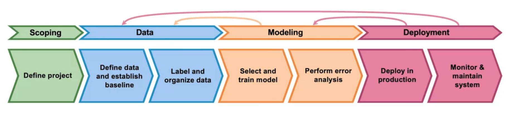
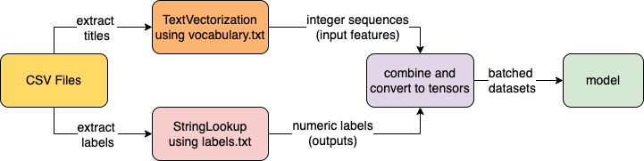
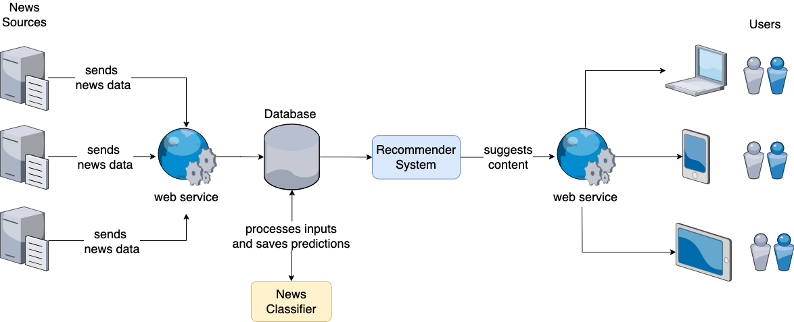
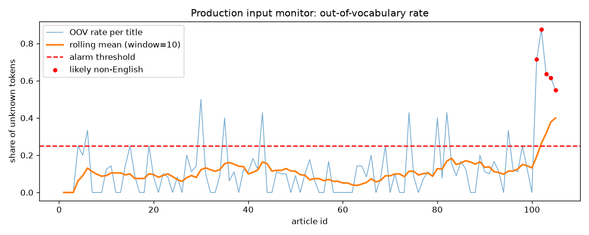

# News Topic Classifier: End-to-End ML Lifecycle and MLOps

[](https://github.com/craigchipendo/MLOps/actions/workflows/ci.yml)


A news-article classifier was prototyped by a previous developer for a news-app start-up and pushed into production. No metrics had been recorded, performance was below expectations, and live traffic was being scored without oversight. In this repository it was rebuilt as an operable ML system: the data was audited and repaired, the baseline was re-measured, data and model were iterated on with tracked experiments, and versioned models were shipped behind TensorFlow Serving with canary releases, human-in-the-loop routing and drift monitoring.

> **Headline:** the prototype's advertised 78% accuracy fell to **0.47 macro-F1 on titles it had never seen**: most of that number came from memorised duplicates and a corrupted BUSINESS class. The replacement model scores **0.77 macro-F1** on the same unseen titles (0.79 on the full leak-free test set), and in production it files **55% of articles automatically at 95% precision** while routing the rest to editors.

<p align="center"></p>

---

## Contents

1. [What this project demonstrates](#what-this-project-demonstrates)
2. [Results](#results)
3. [Quick start](#quick-start)
4. [Project structure](#project-structure)
5. [The lifecycle, stage by stage](#the-lifecycle-stage-by-stage)
6. [Serving and deployment](#serving-and-deployment)
7. [Monitoring](#monitoring)
8. [Reproducibility and engineering practices](#reproducibility-and-engineering-practices)
9. [Command reference](#command-reference)
10. [Known limitations and next steps](#known-limitations-and-next-steps)
11. [Documentation map](#documentation-map)

---

## What this project demonstrates

| Lifecycle stage | What was built |
|---|---|
| **Scoping** | Business, model and ops success metrics defined up front; ethics and labelling questions raised with stakeholders ([notes](docs/PROJECT_NOTES.md#1-scoping)) |
| **Data** | Automated validation (schema, collapsed classes, duplicates, label conflicts, class balance); repair of a corrupted class from URL slugs; de-duplication; stratified, leak-free, **hash-versioned** splits with a manifest |
| **Modeling** | Config-driven experiments (E1 to E8 + a classical benchmark), per-topic and top-2 error analysis, label-ambiguity study, EDA augmentation, architecture comparison; a **data-quality gate** that blocks promotion of models trained on bad data |
| **Tracking** | Every run logged to a git-diffable CSV ledger **and** MLflow (params, metrics, artifacts) |
| **Deployment** | Preprocessing baked into the exported SavedModel (removes training/serving skew); a model **registry** generating TF Serving configs; **stable / canary / deprecated** labels; canary gate with **contamination control**; one-command rollback |
| **Automation** | Confidence threshold **calibrated on dev** for a 95% precision target; routing to `auto.csv` / `manual.csv` with OOV and language guards |
| **Monitoring** | Input metrics (OOV rate, language guard, PSI drift), output metrics (topic mix, confidence, agreement with the previous model), alarms with a runbook |
| **Engineering** | Installable package + CLI, unit and end-to-end tests, ruff, pre-commit, GitHub Actions CI, Docker Compose for TF Serving, deterministic training |

## Results

All neural runs use the same leak-free split (60,552 / 20,184 / 20,184 titles) unless noted. The champion is chosen on **dev** macro-F1; test is reported, never used to choose.

| Exp | What changed | Test acc | Test macro-F1 | SCIENCE F1 | Auto-filed at 95% precision | Promotable |
|---|---|---:|---:|---:|---:|:---:|
| E1 | Inherited prototype, its own test file | 0.778 | 0.768 | 0.714 | n/a | no |
| E2 | Stratified re-split, data **not** repaired | 0.814 | 0.813 | 0.807 | 62.5% | **no** (fails data-quality gate) |
| E3 | Repaired BUSINESS titles, de-duplicated, leak-free split; prototype architecture | 0.755 | 0.753 | 0.762 | 46.6% | yes |
| **E4** | **Pooled embeddings, 20k vocab, dropout, class weights, early stopping** | **0.794** | **0.794** | **0.804** | **55.1%** | **champion** |
| E5 | E4 + EDA augmentation of SCIENCE (train only) | 0.790 | 0.790 | **0.825** | 53.9% | yes |
| E6 | Bidirectional LSTM | 0.778 | 0.774 | 0.771 | 51.8% | yes |
| E7 | 1D CNN + stop-word removal | 0.774 | 0.772 | 0.771 | 49.7% | yes |
| E8 | E4 with merged taxonomy (6 topics) | 0.846 | 0.845 | n/a | 68.9% | no (study) |
| B1 | TF-IDF word + char n-grams, logistic regression | 0.819 | 0.821 | 0.849 | n/a | no (benchmark) |

**What the numbers say**

* **E2 looked like progress and was not.** Every BUSINESS row shared one title, so BUSINESS scored a perfect 1.00 F1. The data-quality gate marks E2 non-promotable no matter how good it looks.
* **E3 is the first honest number.** It is lower than E1 and E2 because nothing in the test set leaks from training any more.
* **E4 is the biggest model-side gain** (+4 points macro-F1 over E3): pooling instead of position-bound Flatten, regularisation, and class weights for the 3% SCIENCE class.
* **Heavier architectures (E6, E7) did not help** on 10-20 token headlines. E5's augmentation lifted SCIENCE F1 but not overall macro-F1.
* **The linear benchmark (B1) beats every neural model by about 2.5 points.** Title-only classification is close to its ceiling; the next gains come from labels and features, not architecture.
* **Label ambiguity is the ceiling.** Top-2 accuracy is ~91%; WORLD and NATION recall jump 20+ points when the second guess counts; merging overlapping topics (E8) adds 5 points. This is a product decision, documented for the product owner.

**Canary check (unseen titles only).** 13,780 test titles were removed because the prototype had trained on them; on the remaining 6,404:

| | Accuracy | Macro-F1 | BUSINESS F1 | SCIENCE F1 |
|---|---:|---:|---:|---:|
| Stable (inherited prototype) | 0.419 | 0.467 | 0.000 | 0.428 |
| Canary (E4) | 0.806 | 0.770 | 0.879 | 0.875 |

## Quick start

**Prerequisites:** Python 3.10 to 3.12 (3.13 works with TensorFlow 2.20), about 3 GB of disk for TensorFlow, and optionally Docker for TF Serving.

```bash
git clone https://github.com/craigchipendo/MLOps.git
cd MLOps

python -m venv .venv
source .venv/bin/activate          # Windows PowerShell: .venv\Scripts\Activate.ps1
pip install --upgrade pip
pip install -e ".[dev,augment]"
python -c "import nltk; nltk.download('wordnet')"   # optional: enables EDA synonym ops

pytest                             # 20 tests, ~15 s
```

**Run the whole lifecycle** (about 10 minutes on a laptop CPU):

```bash
make pipeline
```

or the same steps without `make` (Windows):

```bash
newsclf validate                   # data audit -> reports/data_validation_raw.json
newsclf run-all                    # E1 baseline, E2-E8, B1 benchmark, leaderboard, champion
newsclf deploy                     # legacy -> stable (v1), champion -> canary (v2)
newsclf canary-check --promote     # gate on unseen titles; promote if it passes
newsclf route --input data/processed/<data_version>/dev.csv   # auto.csv / manual.csv
newsclf monitor                    # drift report + alarms on the production log
```

**Serve it and call it:**

```bash
newsclf serve                      # TF-Serving-compatible REST server on :8501 (docs at /docs)
# or, with Docker:
docker compose -f serving/docker-compose.yml up -d

curl -d '{"instances": ["NASA telescope spots water on a distant exoplanet"]}' \
     -X POST http://localhost:8501/v1/models/newsapp_model/labels/stable:predict
```

**Walk through the story:** open [`notebooks/01_ml_lifecycle_walkthrough.ipynb`](notebooks/01_ml_lifecycle_walkthrough.ipynb). It reuses the trained artifacts if present and trains them otherwise.

**Browse experiments in MLflow:** `make mlflow-ui` (or `mlflow ui --backend-store-uri sqlite:///mlflow.db`), then open http://127.0.0.1:5000.

## Project structure

```
news-topic-classifier/
├── configs/
│   ├── base.yaml                     # single source of truth for defaults
│   └── experiments/E2..E8_*.yaml     # each experiment overrides only what it changes
├── data/
│   ├── raw/                          # inherited train/test CSVs + production log (news_articles.db)
│   └── processed/<data_hash>/        # generated: versioned splits + manifest.json (gitignored)
├── models/legacy/e1_baseline/        # inherited prototype SavedModel + vocab (kept for baseline/rollback)
├── src/newsclf/
│   ├── config.py                     # YAML loading, deep merge, data hashing
│   ├── data/                         # ingest, validate, repair, augment (EDA), prepare (split + version)
│   ├── features/text.py              # TextVectorization build/fit/save, stop-word standardiser, OOV rate
│   ├── models/                       # architectures, train loop, legacy E1 evaluation, TF-IDF benchmark
│   ├── evaluation/                   # metrics, calibration, routing curve, error analysis, plots
│   ├── tracking.py                   # CSV ledger + MLflow
│   ├── serving/                      # registry, export, predictor backends, local TF-Serving-compatible API
│   ├── deployment/routing.py         # human-in-the-loop routing policy
│   ├── monitoring/drift.py           # input profiler, PSI, alarms, output metrics
│   ├── pipelines.py                  # lifecycle stages wired together
│   └── cli.py                        # `newsclf` command
├── serving/
│   ├── docker-compose.yml            # tensorflow/serving with generated config
│   ├── run_tf_serving_native.sh      # tensorflow_model_server (APT) alternative
│   └── models/                       # generated: versions 1..N + models.config files (gitignored)
├── notebooks/01_ml_lifecycle_walkthrough.ipynb
├── reports/                          # experiment ledger, leaderboard, champion, canary, monitoring
├── artifacts/<experiment>/           # generated: model, vocab, metrics, plots, routing policy (gitignored)
├── docs/                             # project notes, model card, runbook, diagrams
├── tests/                            # unit + end-to-end (train -> export -> serve -> route)
├── .github/workflows/ci.yml
├── Makefile · pyproject.toml · requirements*.txt · .pre-commit-config.yaml
```

## The lifecycle, stage by stage

### 1. Scoping

The app needs to file articles under eight topics (BUSINESS, ENTERTAINMENT, HEALTH, NATION, SCIENCE, SPORTS, TECHNOLOGY, WORLD) from the title alone, at the pace new sources come online. Success was defined at three levels before any code was written: **share of articles auto-filed at >= 95% precision** (business), **macro-F1 and per-topic F1** (model, because accuracy hides the 3% SCIENCE class), and **train/serve parity, rollback and drift alarms** (operations). Full scoping notes, stakeholder questions and the 3-week plan: [docs/PROJECT_NOTES.md](docs/PROJECT_NOTES.md#1-scoping).

### 2. Data

`newsclf validate` found four problems in the inherited data:

| Finding | Evidence | Fix in the pipeline |
|---|---|---|
| BUSINESS collapsed to one title | 15,000 rows, 1 unique title ("Why iPhone 12 Will Be Another 'Defining Chapter'...") | `data/repair.py` rebuilds titles from a trusted reference file if supplied, else from the URL slug: 14,009 recovered, 991 dropped |
| Duplicate titles | 21,329 duplicates across train and test | De-duplicate on normalised title before splitting |
| Label conflicts | 348 titles with more than one label | Majority vote, logged, raised with the labelling team |
| Skewed split | SCIENCE was 0.7% of train but 13.2% of test | Pool, then stratified 60/20/20 train/dev/test |

Each processed dataset lives in `data/processed/<hash of data config>/` with a `manifest.json` recording file SHA-256s, repair and de-duplication counts, validation reports and a cross-split leakage check (0 shared titles).

<p align="center"></p>

### 3. Modeling

Experiments are YAML overrides of `configs/base.yaml`, so every difference between two runs is visible in a diff. Each run writes to `artifacts/<exp>/`: the Keras model, the fitted vocabulary, `metrics.json` (overall, per-topic, top-2, calibration ECE), confusion matrix, training curves, the dev-calibrated routing policy, top confusions and an error sample. The champion rule is best dev macro-F1 among runs that (a) keep the production label space and (b) pass the data-quality gate (no collapsed classes, zero titles shared across splits).

Improvement methods implemented and measured: rebalanced splits, data repair, de-duplication, class weighting, early stopping, larger vocabulary, stop-word removal in the vectorizer, pooled/BiLSTM/CNN architectures, EDA augmentation (synonym replacement, random insertion, swap, deletion) on the minority class, merged taxonomy, top-2 evaluation, and a TF-IDF benchmark.

### 4. Deployment

See [Serving and deployment](#serving-and-deployment).

### 5. Monitoring

See [Monitoring](#monitoring).

## Serving and deployment

<p align="center"></p>

**No training/serving skew.** Clients were required by the prototype to tokenize titles themselves. Loading the wrong vocabulary file drops its accuracy from 77.8% to 13.2% with no error raised (demonstrated in the notebook). Every exported model wraps the fitted `TextVectorization` layer in front of the network, so the SavedModel signature is `serving_default(title: string[]) -> probabilities[8]`. Each version folder carries `assets.extra/` with `labels.txt`, `vocabulary.txt` and `model_card.json`.

**Registry and labels.** `serving/registry.json` is the source of truth; `models.config` (native) and `models.docker.config` (container) are generated from it.

```
v1  E1 legacy prototype   input: 20 token ids   -> deprecated   (kept loaded for rollback)
v2  E4 champion           input: raw strings    -> stable
```

**Release flow:**

1. `newsclf deploy`: legacy as `stable`, champion as `canary`.
2. `newsclf canary-check`: compares both on test titles **neither model trained on**, requires a macro-F1 gain and no topic losing more than 5 F1 points.
3. `newsclf promote`: canary becomes stable, old stable becomes deprecated. Rollback is `newsclf promote --version 1`. TF Serving polls its config every 10 s, so no restart.

**Endpoints** (identical on TF Serving and on the bundled local server):

```
GET  /v1/models/newsapp_model
POST /v1/models/newsapp_model:predict
POST /v1/models/newsapp_model/versions/{n}:predict
POST /v1/models/newsapp_model/labels/{stable|canary|deprecated}:predict
POST /v1/classify          # local server only: topics + routing decision + language/OOV guard
```

**Running TF Serving.** `docker compose -f serving/docker-compose.yml up -d` (image tag set by `TF_SERVING_TAG`; defaults to `latest`, pin a version for production), or `bash serving/run_tf_serving_native.sh` with the APT binary on Linux. When Docker is not available, `newsclf serve` provides the same REST contract from Python so the rest of the workflow is unchanged.

**Human in the loop.** For each model, the confidence threshold is the lowest value at which the **dev** auto-filed bucket reaches 95% accuracy (E4: 0.90). On test it auto-files 55.1% of titles at 95.2% accuracy. Titles go to `manual.csv` if confidence is low, more than half the tokens are out of vocabulary, or the title looks non-English. On the dev set, the titles routed to editors would have been only 60% correct if automated.

## Monitoring

`newsclf monitor` profiles the production log (`data/raw/news_articles.db`, whose stored softmax scores are float32 blobs that get decoded) against the stable model's vocabulary and training data:

* **Input:** per-title token count, OOV rate, English function-word ratio, non-ASCII ratio, language guard; PSI of title length and OOV rate versus training.
* **Output:** predicted topic mix, mean confidence, share below the routing threshold, agreement between the logged prototype scores and the current model (70%).
* **Alarms:** batch and rolling-window OOV rate, non-English inputs, length-distribution shift.

<p align="center"></p>

On the shipped log the rolling OOV alarm fires at article 102: `corriere.it` started sending Italian headlines that the prototype scored with confident but meaningless topics. The language guard now routes those to editors, and the alarm names the source domain. Alarm responses are in the [runbook](docs/RUNBOOK.md#5-monitoring-and-alarms).

## Reproducibility and engineering practices

* **Config as code:** one base YAML + per-experiment overrides; the resolved config is saved with every run.
* **Data versioning:** processed datasets are keyed by a hash of the data config and seed, with SHA-256 file hashes in the manifest. Raw data is committed (about 24 MB); for larger data, swap in DVC or Git LFS.
* **Determinism:** global seeds plus `tf.config.experimental.enable_op_determinism()`.
* **Experiment tracking:** CSV ledger (`reports/experiment_tracker.csv`) and MLflow (SQLite backend, artifacts in `mlruns/`). MLflow failures never break training.
* **Quality gates:** data validation before training, data-quality gate before export, canary gate before promotion.
* **Testing:** 20 tests covering repair, validation, splitting, augmentation, metrics, routing, PSI, the registry, and an end-to-end train, export, serve and route run on synthetic data.
* **CI:** GitHub Actions runs ruff, pytest and a pipeline smoke test on Python 3.11 and 3.12.
* **Generated outputs are gitignored** (`artifacts/`, `data/processed/`, `serving/models/`, `mlruns/`); `make pipeline` rebuilds them.

## Command reference

| Command | Purpose |
|---|---|
| `newsclf validate` | Audit raw data, write `reports/data_validation_raw.json` |
| `newsclf prepare -e E3 [--force]` | Build or reuse versioned splits |
| `newsclf baseline` | E1: re-measure the inherited prototype |
| `newsclf train -e E4 [E5 ...] [--epochs N] [--no-mlflow]` | Train experiments |
| `newsclf benchmark` | B1: TF-IDF + logistic regression |
| `newsclf run-all` | E1, all experiments, B1, leaderboard, champion |
| `newsclf leaderboard` | Rank runs, write `reports/leaderboard.{csv,md}`, select champion |
| `newsclf deploy [--candidate E5]` | Legacy as stable, champion (or candidate) as canary |
| `newsclf export -e E5 --label canary` | Export any promotable run as a new version |
| `newsclf canary-check [--url URL] [--promote]` | Canary vs stable on unseen titles |
| `newsclf promote [--version N] [--label stable]` | Move labels; rollback |
| `newsclf registry` | Show versions and labels |
| `newsclf serve [--port 8501]` | Local TF-Serving-compatible API |
| `newsclf predict "title" ... [--url URL] [--label canary]` | Classify titles |
| `newsclf route --input file.csv [--url URL]` | Write `auto.csv` / `manual.csv` |
| `newsclf monitor [--url URL] [--db path]` | Monitoring report and alarms |

`--url` points any command at a running TF Serving or local server; without it, commands load the SavedModels in-process.

## Known limitations and next steps

* **BUSINESS titles are reconstructed from URL slugs** (no punctuation, some stop words dropped by publishers). If the original backup is found, drop it in `data/raw/` and set `data.reference_titles_file`; the repair step prefers it automatically.
* **The best model (B1, TF-IDF + logistic regression) is not served**, because TF Serving needs a TensorFlow graph. Next: port it into the graph (TF-IDF `TextVectorization` + linear layer) or serve it from the FastAPI service.
* **Title-only input caps performance.** Next: add the article description, try a small pre-trained transformer, and resolve the WORLD/NATION and SCIENCE/TECHNOLOGY taxonomy with the product owner.
* **The TF Serving container path is configured but was not exercised in the build environment** (no Docker registry access there); the exported SavedModels and generated configs follow TF Serving's documented layout, and the identical REST flow is covered by the local server and tests.
* **Scheduling** of re-training and monitoring (cron, Airflow or GitHub Actions on a schedule) is left to the target platform; the CLI commands are the units to schedule.

## Documentation map

| Document | What it covers |
|---|---|
| [docs/PROJECT_NOTES.md](docs/PROJECT_NOTES.md) | Chronological engineering log: findings, decisions, procedures for every stage |
| [docs/MODEL_CARD.md](docs/MODEL_CARD.md) | Intended use, data, metrics, limitations, ethics |
| [docs/RUNBOOK.md](docs/RUNBOOK.md) | Release, rollback, serving, monitoring and re-training procedures |
| [notebooks/01_ml_lifecycle_walkthrough.ipynb](notebooks/01_ml_lifecycle_walkthrough.ipynb) | Narrative walkthrough with live outputs |
| `reports/` | Experiment ledger, leaderboard, champion, canary, routing and monitoring reports |

---

Dataset: a revised version of the [Topic Labeled News Dataset](https://www.kaggle.com/datasets/kotartemiy/topic-labeled-news-dataset). Licensed under MIT (see [LICENSE](LICENSE)).
